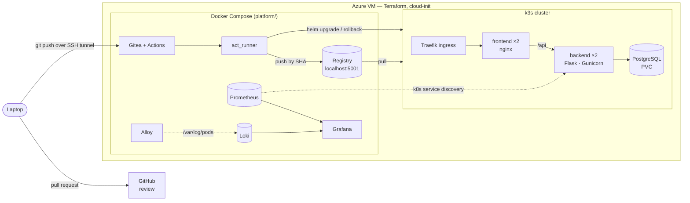

# Project A — Automated Delivery Chain on Self-Hosted CI/CD

> Commit → lint · test · scan → build → registry → Helm deploy to k3s → verify → roll back on failure — and a measurement of what that automation is actually worth.
> **BSc thesis, NJE GAMF** (mérnökinformatikus) · built on the **TCS DevOps internship** CI/CD project · Owner: **Milán Takács**


Thesis title (Hungarian): *Automatizált telepítési lánc kiépítése és hatásának
mérése saját üzemeltetésű CI/CD környezetben.* The thesis plan, measurement
protocol, work log and all measurement evidence live in
[`szakdolgozat/`](szakdolgozat/); the work log
([`szakdolgozat/naplo.md`](szakdolgozat/naplo.md)) is the place to start.

---

## What it does

A small notes application (Flask backend, React frontend, PostgreSQL) is
delivered to a single-node k3s cluster on an Azure VM by a self-hosted Gitea
Actions pipeline. The VM is created by Terraform; k3s comes up from cloud-init
with no manual step.

```
push → build-test-push (ruff · secret scan · hadolint · pytest · ansible-lint · build · Trivy · push)
     → deploy (helm upgrade --wait · verify · helm rollback on failure)
```

The research question: **how much does the automation improve delivery,
measured?** The same trivial change was deployed by hand (a fixed 13-step
protocol) and through the pipeline, ten times each, to the same cluster, and a
deliberately broken release was recovered three times each way.

## Results (summary)

| | Manual | Pipeline |
|---|---:|---:|
| Total time, median (range) | 71 s (64–79)¹ | 129.5 s (115–144) |
| … of which without the quality gates | 71 s (64–79)¹ | 69 s (67–72) |
| Deploy phase (helm → accepted), median | 31 s (29–40)¹ | 24 s (23–26) |
| Human interventions, deploy | 13 | 2 |
| Outage after a bad release, median | 56 s (50–57) | 26 s (25–28) |
| Human interventions, recovery | 19 | 2 |

¹ steady-state runs 4–10; all ten runs are reported alongside in the thesis.

The pipeline is not faster end to end: it does 48–73 s more work (linting,
tests, two vulnerability scans) in the same order of time, with two human
interventions instead of thirteen. Machine waiting (rollout) is the same on
both sides; what disappears is the typed and read part. Data and method:
[`szakdolgozat/bizonyitek/meres/`](szakdolgozat/bizonyitek/meres/), figures:
[`szakdolgozat/abrak/`](szakdolgozat/abrak/) (regenerate with
`python3 scripts/abrak-6-fejezet.py`).

## Architecture



CI and the measured cluster share one machine on purpose (Gitea, runner and
registry must be reachable from the cluster); the cost of that is stated in the
thesis as a validity limit. Observability runs outside the cluster and finds
the pods through the k3s API ([ADR-0010](docs/adr/0010-observability-on-k3s.md)).

## Pipeline

```mermaid
flowchart LR
    A[push] --> B[ruff] --> S[Trivy<br/>secret scan] --> H[hadolint<br/>backend + frontend]
    H --> T[pytest<br/>80% gate] --> AL[ansible-lint]
    AL --> D[build both images] --> HG[health gate] --> TV[Trivy<br/>both images]
    TV -->|main + release/*| P[push<br/>SHA tag]
    P --> HU[helm upgrade --wait]
    HU --> V[verify<br/>/version + smoke]
    V -.fails.-> R[helm rollback<br/>+ verify previous SHA]
```



Feature branches build, test and scan but never push. The deploy job records
the running revision before it changes anything, so a failed verification rolls
back to a known SHA and proves it with the same checks
([ADR-0009](docs/adr/0009-helm-replaces-ansible-for-deployment.md)).

## Status

| Area | State |
|---|:--:|
| Backend: `/health`, `/ready`, `/version`, `/metrics`, `/echo`, notes CRUD on PostgreSQL | ✅ |
| Frontend: Vite + React + TypeScript, served by unprivileged nginx | ✅ |
| Terraform: resource group, network, NSG, static IP, VM with k3s via cloud-init | ✅ |
| Helm chart: backend, frontend, PostgreSQL with PVC, schema, Traefik ingress | ✅ |
| Pipeline: build, registry, Helm deploy, verify, automatic rollback | ✅ |
| Supply chain: hash-locked dependencies, digest-pinned base images, Trivy on both images, CycloneDX SBOMs (771 components) | ✅ |
| Observability on k3s: Prometheus pod discovery, pod logs to Loki, dashboards as code | ✅ |
| Measurement: 10 manual + 10 automated deploys, 3 + 3 recoveries | ✅ |
| Base-image digest bump for the current Debian advisories | 🟡 waiting on upstream, `scripts/pin-base-images.sh` |
| Image signing (cosign), GitOps, multi-node cluster, remote Terraform state | ⬜ out of scope — thesis chapter 7 |

## Stack

| Layer | Tool |
|---|---|
| App | Flask 3.1 · Gunicorn · PostgreSQL 17 · React + Vite + TypeScript · nginx |
| Infrastructure | Terraform (`azurerm`) · Azure for Students · cloud-init |
| Cluster | k3s (single node) · Helm · Traefik |
| Review | GitHub — protected branches, CODEOWNERS |
| CI/CD | Gitea + Gitea Actions (`act_runner`), self-hosted on the VM |
| Artifact | two images → `localhost:5001`, tagged by git SHA |
| Scanning | hadolint v2.14.0 · Trivy 0.72.0 (secrets, both images; fails on fixed HIGH/CRITICAL) |
| Inventory | CycloneDX SBOMs via Trivy 0.72.0 — [`docs/sbom/`](docs/sbom/) |
| Observability | Prometheus · Loki · Grafana · Alloy, provisioned as code |

## Endpoints

Through the ingress the backend is under `/api` (nginx strips the prefix).

| Route | Method | Purpose |
|---|---|---|
| `/health` · `/ready` | GET | Liveness · readiness (readiness checks the database) |
| `/version` | GET | The git SHA the image was built from — the acceptance criterion |
| `/notes` | GET · POST | List · create |
| `/notes/<id>` | PUT · DELETE | Update · delete |
| `/echo` | POST | Echo JSON · `400` on an invalid payload |
| `/metrics` | GET | Prometheus metrics, multiprocess-safe under Gunicorn |

## Quick start

Application and tests, locally:

```bash
python3.12 -m venv .venv && source .venv/bin/activate
pip install -r requirements-dev.txt
pytest && ruff check .
```

A disposable cluster on the laptop (k3d) with the same chart:
[`szakdolgozat/02-elso-het-lepesrol-lepesre.md`](szakdolgozat/02-elso-het-lepesrol-lepesre.md),
checked by `scripts/verify-k3d.sh`.

The measurement VM — create, start, stop, rebuild:
[`terraform/README.md`](terraform/README.md) and
[`szakdolgozat/06-merogep-ujraepitese.md`](szakdolgozat/06-merogep-ujraepitese.md).
Day-to-day operation and incidents: [`docs/RUNBOOK.md`](docs/RUNBOOK.md).

## Repository layout

```
.
├── app/                  # Flask backend
├── frontend/             # React frontend + nginx config
├── tests/                # pytest suite
├── chart/                # Helm chart: backend, frontend, postgres, ingress
├── terraform/            # Azure VM + network; cloud-init installs k3s
├── platform/             # compose: Gitea, act_runner, registry, observability
├── ansible/              # verify playbook (used by the deploy job); the old Docker-host deploy role
├── scripts/              # smoke.sh, helm-on-host.sh, verify-*.sh, sbom-generate.sh,
│                         # pin-base-images.sh, abrak-6-fejezet.py, …
├── .gitea/workflows/     # ci.yml — build-test-push + deploy
├── docs/                 # ADRs, runbook, SBOMs, branching, internship plan
└── szakdolgozat/         # thesis plan, work log, evidence, figures, study notes
```

## Docs

| Document | Contents |
|---|---|
| [`szakdolgozat/naplo.md`](szakdolgozat/naplo.md) | Work log — what was done, what it proves (Hungarian) |
| [`szakdolgozat/00-terv.md`](szakdolgozat/00-terv.md) | Thesis plan and measurement protocol (Hungarian) |
| [`szakdolgozat/bizonyitek/`](szakdolgozat/bizonyitek/) | Measurement evidence: CSVs, transcripts, job logs |
| [`docs/RUNBOOK.md`](docs/RUNBOOK.md) | Operating the VM, failed deploy, rollback, leaked secret |
| [`docs/adr/`](docs/adr/) | ADR-0001 … ADR-0010 — why the big decisions were made |
| [`docs/sbom/`](docs/sbom/) | Software inventory — seven CycloneDX SBOMs of the measured release |
| [`docs/BRANCHING.md`](docs/BRANCHING.md) | Branches, merge policy, protection |
| [`docs/DEVELOPMENT.md`](docs/DEVELOPMENT.md) · [`docs/PLAN.md`](docs/PLAN.md) | Internship-era dev guide and plan (Docker host, Ansible) — kept as history |
| [`CHANGELOG.md`](CHANGELOG.md) | What shipped, per checkpoint |

## Where it started

Until 2026-09-21 this was the internship project: one Flask container deployed
by Ansible to a Docker host on the laptop, with the same Gitea pipeline,
scanning and observability. The thesis kept the pipeline and the evidence
discipline and replaced the target: Terraform-built VM, k3s, Helm, a frontend
and a database. ADR-0008 to ADR-0010 record the switch. ADR-0003's Ansible deploy is
superseded by ADR-0009; its verification play still gates every deploy.
